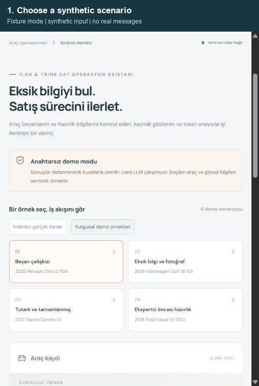

# Agentic Workflow Assistant

**Turn an incomplete or inconsistent vehicle record into a source-backed review
and an unsent seller-message draft; a human approves the local task.**



20-second sequence of real UI captures in **fixture mode**, using synthetic records;
chapter timing is edited. The GIF does not demonstrate live model generation.

[Five-minute review](REVIEWER_GUIDE.md) · [Architecture](docs/ARCHITECTURE.md) ·
[Setup](docs/LOCAL_SETUP.md) · [Actual model results](docs/verification/LOCAL_MODEL_REVIEW.md) ·
[Source ZIP](https://github.com/Mavisier/Mavis-home-practicing-no-313/archive/refs/heads/main.zip)

This is an independent automotive-workflow portfolio demo for Forward Deployed AI
engineering. It is not an official arabam.com product, has no company endorsement,
and uses no private company systems. No real message, listing, booking or payment
is executed. Development used AI coding assistance.

## Try it

Requires Python 3.12–3.14, Node.js 24/npm and uv. From the checkout root:

```powershell
python tools/start_demo.py --setup
```

Open http://127.0.0.1:5173. Choose **Kurgusal demo örnekleri → Beyan çelişkisi**,
review the sources and draft, then approve or reject. Ctrl+C stops the launcher's
own services. Later starts omit `--setup`. First installation needs network access;
fixture operation needs no API account. The command was exercised on Windows with
existing prerequisites; it is not a pristine-machine or cross-platform test.

For a real, keyless **local model**, install Ollama and download the models once:

```powershell
ollama pull qwen2.5:7b
ollama pull nomic-embed-text:v1.5
python tools/start_demo.py --provider ollama --neural
```

Keep Ollama running and stop the previous demo first. Downloads require several GB;
local inference consumes your hardware and electricity. See [setup](docs/LOCAL_SETUP.md).

## What is verified

| Evidence | Result and scope |
| --- | --- |
| Backend and fixture checks | 81 tests, 6/6 workflow evaluations; PGlite/pgvector locally |
| Frontend | Lint, TypeScript check and production build passed |
| Actual Ollama workflow | qwen2.5:7b + 768-dimensional nomic embeddings; 30/30 valid structured results, no task before approval |
| Turkish rule diagnostic | 27/30 expected-label matches after suffix fixes; three known deviations remain |
| Optional integrations | Previously verified n8n import + 8 flow checks; MCP stdio + 2 read-only tools |
| Implemented, unverified | OpenAI/Anthropic generation, OpenAI embeddings, Docker/native PostgreSQL runtime |

**Valid JSON is not correct reasoning.** Local summaries included unsupported
execution wording and reversed missing-field meanings. The model selects bounded
read tools and summarizes backend findings; seller questions and message drafts
are backend-generated. The summary is excluded from task arguments and flagged
for human checking. [Raw runs and quality review](docs/verification/LOCAL_MODEL_REVIEW.md)
include earlier iterations and observed errors. Reused development cases are not
a held-out benchmark, real-world accuracy or measured business impact.

## Why these choices

FastAPI owns authority, React presents evidence, and PostgreSQL persists records,
immutable proposals, tasks and audit. pgvector retrieves four short versioned
sample documents. Schemas and tool/target allowlists bound model output. Approval
checks the stored payload, requester and current vehicle snapshot; database
constraints prevent duplicate tasks. The local proxy lets one operator try both
roles; it does not prove real identity separation.

Fixture mode is the reproducible default. Ollama adds native tool calling and
neural retrieval without paid API calls. The small corpus has no reranker or
semantic retrieval benchmark. Image damage/OCR analysis is not implemented.
Optional n8n orchestrates separate review and human-decision webhooks; MCP exposes
two read-only tools. Details: [architecture](docs/ARCHITECTURE.md).

Docker Compose describes a native PostgreSQL deployment, but its runtime is
**unverified**: Docker Desktop 4.95.0 is installed and `docker compose config`
validated the configuration. The engine is blocked by this host’s Windows services.
Component-store repair completed; Windows reports a pending repair requiring restart.
No container build/start is claimed. The native demo works independently of Docker.

## Review and boundaries

Public source, GIF and evaluation records use synthetic data. A separate local
public-listing trial is excluded. Public visibility does not grant redistribution
rights; obtain appropriate permission for future third-party data use.

No production identity, hosted demo or measured customer impact is claimed. One
test-transport deprecation warning remains. Optional n8n has documented upstream
dependency and retention limitations; prior audits are dated evidence, not a
security certificate. See [SECURITY.md](SECURITY.md), [publication checklist](PRE_PUBLISH_CHECKLIST.md)
and MIT [LICENSE](LICENSE).
