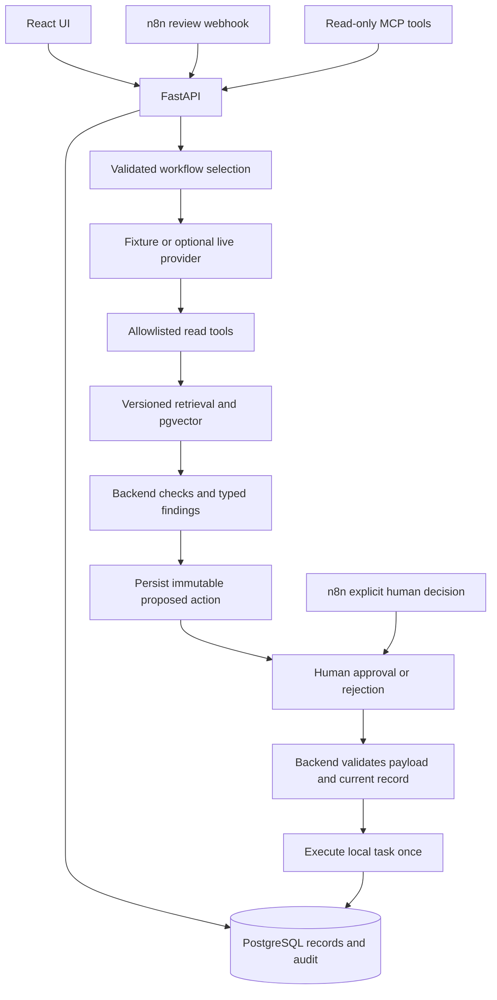
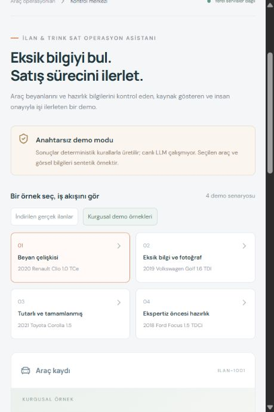
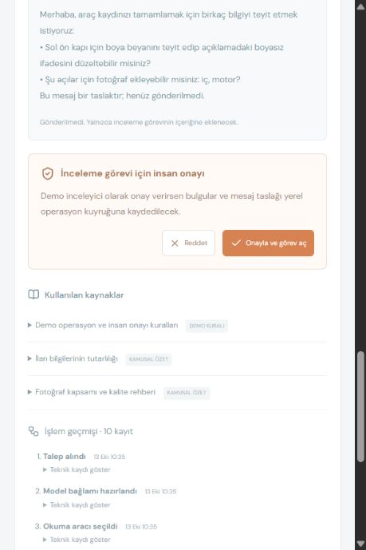
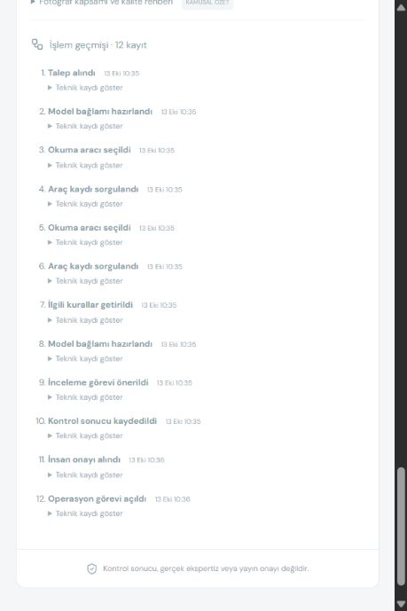

# Agentic Workflow Assistant

[GitHub repository](https://github.com/Mavisier/Mavis-home-practicing-no-313) ·
[Five-minute reviewer guide](REVIEWER_GUIDE.md) ·
[Download source ZIP](https://github.com/Mavisier/Mavis-home-practicing-no-313/archive/refs/heads/main.zip)

Portfolio prototype for Forward Deployed AI engineering: FastAPI, React/TypeScript,
PostgreSQL/pgvector, provider abstraction, retrieval, structured outputs, controlled
tools, human approval, audit trails, evaluation, optional n8n orchestration and
read-only MCP.

**This project demonstrates how an ambiguous business workflow can be translated
into a controlled AI-assisted process with retrieval, structured reasoning, tool
use, approval gates, and measurable execution.**

This is an independent automotive-workflow portfolio demo. It is not an official
arabam.com product, has no company endorsement, and does not use private company systems.

| Status | Capability |
| --- | --- |
| Working / locally verified | Fixture workflow, PostgreSQL/PGlite and pgvector, typed findings, approvals, persisted tasks and audit, 50 backend tests, 6 evaluation cases |
| Integration verified | n8n import + 8 local flow checks; MCP stdio + two read-only tools |
| Implemented, not live-verified | OpenAI/Anthropic generation adapters and optional neural embeddings |
| Not verified / not implemented | Docker/native PostgreSQL runtime; production identity/cloud hosting; image damage/OCR analysis |

**Fixture is the default:** rules/templates and token-hash vectors, no paid API keys.
Passing fixture checks does not measure real-world LLM quality or company outcomes.
Start with [REVIEWER_GUIDE.md](REVIEWER_GUIDE.md) for a five-minute review.

## 1. Overview

An operator reviews a vehicle record, reads grounded findings and seller questions,
then approves or rejects a proposed local review task. No real listing is published,
message sent, inspection booked, or money transferred.

## 2. Why this project exists

The hypothesis is that collecting missing information and preparing an initial
review can reduce repetitive operational work. The prototype tests the workflow
and its safety boundaries. Time savings, conversion and customer adoption have
not been measured. Development used AI coding assistance.

## 3. Demo workflow

Choose **Kurgusal demo örnekleri → Beyan çelişkisi**. The form declares a painted
panel while the description says otherwise. The system reads the record through
allowed tools, retrieves supporting sources, prepares findings and a message draft,
and persists a pending proposal. Approval opens a local task once; rejection does
nothing. A consistent record has no task proposal.

Public listing snapshots/photos were used in a separate local trial, with provenance
and explicit image-analysis limits. They are excluded from the public repository.
A clean checkout opens the synthetic examples automatically.

Use synthetic examples for portfolio demonstrations. Publicly visible listings
are not an automatic license to copy, process or redistribute their content;
future third-party data use requires appropriate permission or licensing.

## 4. Architecture

## 5. Agent / RAG flow

Workflow selection is an explicit validated field, not a claimed natural-language
classifier. A bounded provider plan selects only get_listing/check_photo_coverage
for the authorized record. Backend rules generate findings; the provider explains
them using a Pydantic schema.

Four short Markdown documents carry source/version/workflow metadata. Each short
file is one chunk; empty or oversized files are rejected rather than silently
truncated. Embeddings are prepared before one atomic index update. Retrieval
filters the workflow and embedding space, queries pgvector and logs the sources.
The UI shows their text, origin and version.

Token-hash embeddings make the default demo deterministic. Neural OpenAI embeddings
are optional and require re-ingestion. Both live generation adapters and the neural
path are unverified against live accounts. Missing live credentials fail explicitly;
there is no silent fixture fallback.

## 6. Human approval model

The server loads the persisted action; browser action arguments are not accepted.
It checks requester ownership, a separate reviewer credential, payload hash and
current vehicle snapshot. Transaction/unique constraints prevent duplicate tasks.
Pending, approved/executed and rejected states are persisted and visible.

The shared local proxy lets one demo operator try both roles. It is not production
authentication or real user-role separation.

## 7. n8n orchestration

[n8n/README.md](n8n/README.md) explains the credential-free export and local setup.
One webhook submits a review. A separate, natively authenticated human-decision
webhook submits approval/rejection. The initial branch cannot reach execution.
FastAPI remains authoritative; the app works without n8n.

Local n8n 2.42.7 passed eight flow checks. Its separate npm runtime has upstream
dependency advisories and trigger-header retention limits. It is ignored, not
vendored or production-certified. See [SECURITY.md](SECURITY.md).

## 8. Safety and guardrails

Bounded schemas, tool/target allowlists, parameterized queries, ownership checks,
resolved file-path validation, escaped HTML, explicit approval and idempotency are
tested. User-facing provider exceptions are sanitized. Auth/API credentials remain
server-side and are absent from browser bundles. Automated tests block external
HTTP calls. Real-image angles and damage are not inferred from downloaded previews.

## 9. Evaluation and tests

Last verified: **50 backend tests**, frontend lint/typecheck/build, and **6/6 fixture
evaluation cases** passed. n8n and MCP protocol summaries are in
[docs/verification](docs/verification). Fixture evaluation checks route, findings,
sources, schemas, read-tool selection and approval requirements. It does not claim
AI accuracy. One test-transport deprecation warning remains, unsuppressed.

Core Python and frontend dependency audits found no known advisories at the audit
time. Optional n8n platform findings are documented separately; this is not a
security certification.

## 10. Tech stack

Python 3.12, FastAPI, Pydantic, SQLAlchemy/Alembic, PostgreSQL/pgvector, React,
TypeScript 6.0 and Vite. Python MCP is an optional dependency group. Sample scraping
libraries and audit tools are not core production dependencies. No mandatory agent
framework or production observability platform is added.

## 11. Local setup

PowerShell examples, from the checkout root; Node.js 24/npm, Python 3.12 and uv
are prerequisites. Linux/macOS use the corresponding .venv/bin executables.
Dependencies need network access for installation; fixture operation needs no
external API account.
```powershell
if (-not (Test-Path .env)) { Copy-Item .env.example .env }
New-Item -ItemType Directory -Force .tmp | Out-Null
$env:UV_CACHE_DIR = "$PWD/.tmp/uv-cache"
$env:npm_config_cache = "$PWD/.tmp/npm-cache"
uv sync --directory backend --group mcp
npm ci --prefix frontend
npm ci --prefix tools/local-db
```
The sample environment uses the local PGlite socket on port 55432. This is a
PostgreSQL/Wasm development helper, not native concurrency evidence.
The default one-connection pool serializes database sessions for that helper;
it avoids multiplexed protocol races during parallel UI reads. Pool sizing for
native PostgreSQL must be validated separately.

Terminal 1:
```powershell
npm start --prefix tools/local-db
```
Terminal 2:
```powershell
Set-Location backend
.\.venv\Scripts\python.exe -m scripts.bootstrap
.\.venv\Scripts\python.exe -m uvicorn app.main:app --host 127.0.0.1 --port 8000
```
Terminal 3:
```powershell
npm run dev --prefix frontend
```
Open http://127.0.0.1:5173 and API docs at http://127.0.0.1:8000/docs.
These localhost links refer to the reviewer's own computer, not an online deployment.

Docker target setup:
```powershell
docker compose up --build -d
docker compose down
```
Docker was unavailable here. The configuration was reviewed statically; container
build/runtime were **not** verified. Compose overrides the database URL for its
native PostgreSQL service.

Tests from backend:
```powershell
.\.venv\Scripts\python.exe -m pytest -q
.\.venv\Scripts\ruff.exe check .
.\.venv\Scripts\python.exe -m alembic check
.\.venv\Scripts\python.exe ..\evals\run.py
```
Frontend: npm run lint, npm run typecheck and npm run build.
Optional integrations: [n8n](n8n/README.md), [read-only MCP](examples/mcp/README.md).
For live generation, set the matching provider/key/model locally and restart;
these paths are implemented but not live-certified.

## 12. Three-minute demo

1. Open the synthetic contradiction example and run a review.
2. Expand a supporting source and read the typed finding.
3. Inspect the proposed task and unsent seller-message draft.
4. Approve, inspect the task queue, and reopen its audit history.
5. Try the consistent record: no task is proposed.
6. Optionally run the same scenario through n8n or read its status over MCP.

## 13. Screenshots

Only synthetic-data screenshots are included; third-party listing photos and their
screenshots remain in ignored local artifacts.





## 14. Current limitations

No production deployment/authentication, native PostgreSQL/Docker verification,
live-provider validation, real image damage analysis or real business-impact claim.
Core tests use PGlite; optional n8n is an external platform with its own security/
retention obligations. The simple rules are not a complete moderation policy.

## 15. Production next steps

Validate live generation/retrieval with domain experts, measure false findings and
review time in a controlled pilot, verify native deployment, and introduce real
identity/access controls and data retention policy. These are next steps, not
implemented production features.

Publication: [PRE_PUBLISH_CHECKLIST.md](PRE_PUBLISH_CHECKLIST.md),
[SECURITY.md](SECURITY.md), MIT [LICENSE](LICENSE).
