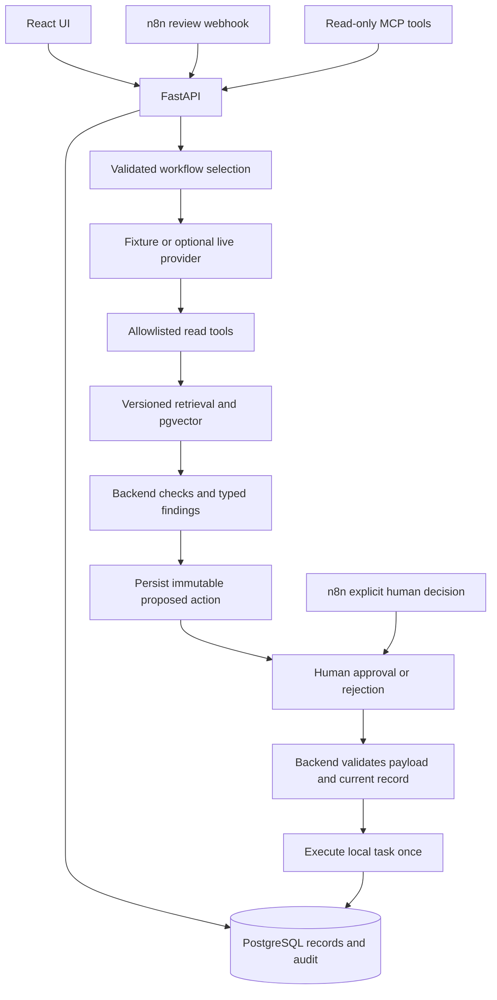

# Architecture

## Agent / RAG flow

Workflow selection is an explicit validated field, not a claimed natural-language
classifier. A bounded provider plan selects only get_listing/check_photo_coverage
for the authorized record. Backend rules generate findings; the provider explains
them using a Pydantic schema.

Four short Markdown documents carry source/version/workflow metadata. Each short
file is one chunk; empty or oversized files are rejected rather than silently
truncated. Embeddings are prepared before one atomic index update. Retrieval
filters the workflow and embedding space, queries pgvector and logs the sources.
The UI shows their text, origin and version.

Token-hash embeddings make the default demo deterministic. Local Ollama embeddings
(nomic-embed-text:v1.5, 768 dimensions) were exercised with the full workflow.
Switching spaces requires re-ingestion. OpenAI embeddings and OpenAI/Anthropic
generation remain implemented but unverified. Missing provider configuration fails
explicitly; there is no silent fixture fallback.

## Human approval model

The server loads the persisted action; browser action arguments are not accepted.
It checks requester ownership, a separate reviewer credential, payload hash and
current vehicle snapshot. Transaction/unique constraints prevent duplicate tasks.
Pending, approved/executed and rejected states are persisted and visible.

The shared local proxy lets one demo operator try both roles. It is not production
authentication or real user-role separation.

## n8n orchestration

[n8n/README.md](n8n/README.md) explains the credential-free export and local setup.
One webhook submits a review. A separate, natively authenticated human-decision
webhook submits approval/rejection. The initial branch cannot reach execution.
FastAPI remains authoritative; the app works without n8n.

Local n8n 2.42.7 passed eight flow checks. Its separate npm runtime has upstream
dependency advisories and trigger-header retention limits. It is ignored, not
vendored or production-certified. See [SECURITY.md](SECURITY.md).

## Safety and guardrails

Bounded schemas, tool/target allowlists, parameterized queries, ownership checks,
resolved file-path validation, escaped HTML, explicit approval and idempotency are
tested. User-facing provider exceptions are sanitized. Auth/API credentials remain
server-side and are absent from browser bundles. Automated tests block external
HTTP calls. Real-image angles and damage are not inferred from downloaded previews.

## Local model authority

Ollama performs native read-tool planning. Backend rules compute findings. For
nonempty findings, the model receives only typed findings and applicable source
text and generates a short structured summary. The original listing description
is excluded from that explanation prompt. Questions and the unsent seller-message
draft come from backend templates; a result without findings uses approved fixed
wording after the model's planning step. These are explicit policies, not error
fallbacks. `explanation_kind` records which path produced the wording.

The generated summary is displayed for human review but excluded from task
arguments. Narrow lexical checks reject selected intent/image claims and emit
`model_output_rejected` without an action. They cannot establish general factual
correctness: observed summaries still reverse meanings or imply an action already
happened. See [measured examples](verification/LOCAL_MODEL_REVIEW.md).

This is a bounded AI-assisted workflow, not an autonomous general-purpose agent.
No model selects SQL, shell commands or arbitrary destinations. Workflow choice
is explicit, findings are rule-based, and only a human-approved local task is
executed. The architecture is deliberately small enough to explain in an interview.
