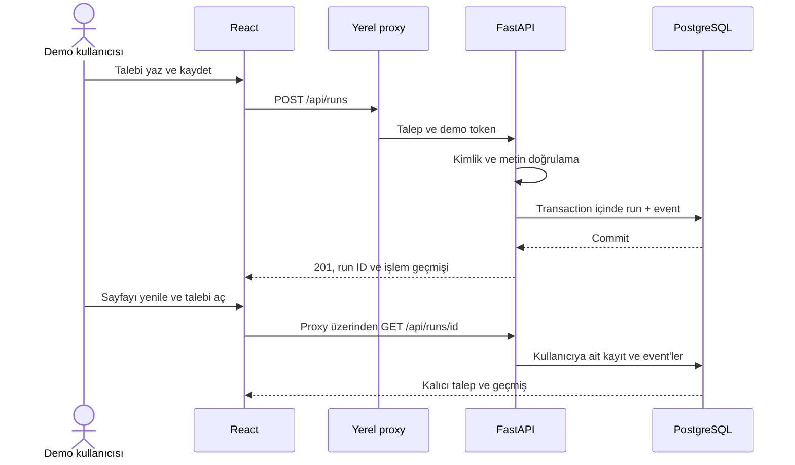

# Aşama 1 — talebin kalıcı ve izlenebilir hale gelmesi

Bu aşamanın sonucu: arayüzden bir talep gönderiliyor; FastAPI talebi ve ilk audit event'ini veritabanına kaydediyor; talep listeden tekrar açılıyor. Sayfa yenilenince veri kaybolmuyor.

## Neden AI'dan önce bu adım?

Model eklediğimizde iki farklı hata kaynağını ayırabilmeliyiz: iş akışının altyapısı ve modelin kararı. Kayıt, doğrulama ve işlem geçmişi önceden çalışırsa RAG veya tool calling hatalarını araştırmak daha kolay olur. Mülakatta ilk anlatım: "Modelin ne yaptığına bakmadan önce, talebin ve sonuçların nerede tutulduğunu netleştirdim."

## Çalışan akış

## Altı karar

1. **Pydantic ile API sınırında doğrulama:** Boş veya 4000 karakterden uzun metinler reddedilir. Kullanıcı `requester_id` veya `status` göndererek kimliğini veya sonucu değiştiremez. Sözleşme `app/schemas.py` içindedir.
2. **Sunucu tarafından belirlenen kimlik:** `app/auth.py` demo token'ını doğrular ve sabit requester kimliğini verir. Proxy token'ı tarayıcı paketine gömmez. Bu bir yerel demo mekanizmasıdır; kurumsal login değildir.
3. **Tek transaction:** `app/api/runs.py` talep ve event'i birlikte commit eder. Event yazılamazsa talep de geri alınır. SQLAlchemy session ve transaction modeli bunun için kullanılır. [Resmi session dokümantasyonu](https://docs.sqlalchemy.org/en/20/orm/session_basics.html).
4. **Alembic migration:** Backend açılırken gelişigüzel tablo yaratılmaz. Şema değişimi sürümlüdür. İlk migration `vector` extension'ını, `runs`, `run_events`, `orders` ve `support_tickets` tablolarını oluşturur. Belge tabloları Aşama 2'de gelecek.
5. **Liveness ve readiness ayrı:** `/health` API'nin cevap verdiğini söyler. `/health/ready`, DB, migration tablosu, runs tablosu ve pgvector'ı kontrol eder. Compose, backend'i migration tamamlanınca başlatır; frontend readiness sonrası açılır. [Compose startup order](https://docs.docker.com/compose/how-tos/startup-order/).
6. **`received` durumu:** Bir talebin kaydedilmesi, AI tarafından cevaplandığı anlamına gelmez. UI şu anda yalnızca gerçekleşmiş event'i gösterir; gelecekteki adımlar açıkça sonraki aşama olarak etiketlidir.

## Kodu okuma sırası

- `backend/app/schemas.py`: hangi istek ve cevap biçimleri kabul ediliyor?
- `backend/app/models.py`: kayıtlar nasıl temsil ediliyor?
- `backend/app/api/runs.py`: doğrulanan istek nasıl DB işlemine dönüşüyor?
- `backend/migrations/versions/0001_foundation.py`: şema nasıl oluşturuluyor?
- `frontend/src/api.ts`: UI backend ile nasıl konuşuyor?
- `frontend/src/App.tsx`: form, liste, işlem görünümü ve hata durumları nasıl bağlanıyor?

Senaryo kartı yalnızca talep örneğini metin kutusuna koyar. İade, HR, pazarlama ve destek için AI veya araç çalıştırma henüz yoktur.

## Veritabanı seçeneği ve sınır

Compose hedefi native PostgreSQL/pgvector. Bu bilgisayarda Docker bulunmadığından çalışan doğrulama `tools/local-db` ile yapıldı: PGlite, TCP PostgreSQL protokolü ve pgvector. Uygulamanın Python veritabanı katmanı değişmedi; bağlantı URL'si değişti.

Bu yardımcı, tek process geliştirme içindir. Native PostgreSQL'in concurrency, bağlantı yönetimi veya Docker volume davranışını kanıtlamaz. [PGlite Socket açıklaması](https://pglite.dev/docs/pglite-socket).

## Doğrulama kaydı

- 12 pytest testi geçti: kalıcı kayıt, audit, input sınırları, kimlik sahteciliği, yanlış token, başka kullanıcının kaydına erişim, kayıp ID, transaction rollback ve gerçek vector query.
- Ruff lint ve TypeScript/production build geçti.
- Seed ikinci kez çalıştırıldığında mevcut kayıtları sıfırlamaz.
- Tarayıcıdan DEMO-1042 iade talebi kaydedildi; sayfa yenilendikten sonra kayıt ve event tekrar açıldı.
- 390px mobil ve 1440px masaüstü genişliklerinde yatay taşma kontrol edildi. Uzun talep metninin grid genişliğini büyütmesi `min-width: 0` ile düzeltildi.
- Compose YAML statik kontrolü yapıldı; Docker bulunmadığından container build ve runtime testi yapılmadı.

## Küçük öğrenme alıştırması

Bir talep oluştur ve API docs üzerinden aynı ID'yi oku. Ardından geçersiz token ile okumayı dene. Beklenen sonuçlar 201 → 200 → 401. Böylece React ekranının ötesinde, sözleşmenin backend'de de uygulandığını görebilirsin.

## Sonraki adım

Aşama 2'de kurgusal çalışan el kitabını ekleyip belge parçalama, embedding, retrieval ve kaynak gösteren HR yanıtını oluşturacağız. O noktada LLM provider ve embedding kararlarını ayrı ayrı ele alacağız.
