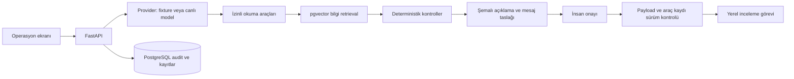

# İlan ve Trink Sat Operasyon Asistanı

**Güncelleme:** Kullanıcının isteğiyle beş gerçek ilan ve 122 fotoğraf yerel test girdisi olarak eklendi. Ayrıntılar ve güncel sınırlar [REAL-LISTING-TRIAL.md](REAL-LISTING-TRIAL.md) içinde. Aşağıdaki ilk demo anlatımı kurgusal örnekler içindir.

Bu belge önceki genel refund/HR planını otomotiv odaklı bir demo ile daraltır. Çalışma kökü yine yalnızca `arabamcomicin`.

## Ürün gerekçesi

arabam.com'un herkese açık ilan rehberi AI ile açıklama oluşturma özelliğini zaten anlatıyor. Yeni demo, beyan tutarlılığı ve eksik bilgi tespitinden onaylı bir operasyon görevine uzanan süreci gösteriyor. Gerçek şirketin bu özelliği kullanmadığı veya belirli bir dahili sorunu olduğu iddia edilmiyor.

Hedeflenen fayda bir hipotez: operasyon ekibinin eksik bilgileri toplama ve ilk inceleme notunu hazırlama yükünü azaltmak. Gerçek zaman kazancı ancak şirket verisi, operasyon ekibi ve pilot kullanım ile ölçülebilir.

## Ekrandan deneme

1. **Beyan çelişkisi:** formda sol ön kapı boyalı; açıklamada boyasız. Kontrolü çalıştır, kaynakları aç, mesaj taslağını gör, görevi onayla. İnceleme kuyruğunda yeni kayıt görünür.
2. **Eksik bilgi ve fotoğraf:** boya ve hasar alanları bilinmiyor; fotoğraf metadata'sı sınırlı ve düşük çözünürlüklü. Eksik alanlar yokmuş gibi yorumlanmaz.
3. **Tutarlı ve tamamlanmış:** kontrol başlığı çıkmaz; yayın veya satın alma onayı verilmez.
4. **Ekspertiz öncesi hazırlık:** kısa muayene süresi ve yedek anahtar beyanı randevu öncesi teyit başlıklarıdır. Fiyat hesaplanmaz.

Satıcı açıklamasını düzenleyip kaydetmek ve tekrar kontrol çalıştırmak mümkündür. Eski bir sonuçtan alınan onay, kayıt değiştiyse backend tarafından reddedilir.

## Mevcut mimari

## Kanıt ve sınırlar

- Çalışan sürüm **fixture** modunda. Araçlar, kontroller, mesaj şablonları ve 128 boyutlu token-hash vektörler deterministiktir. Bu vektörler neural/semantic embedding değildir; canlı LLM veya semantik RAG kalitesi kanıtı sayılmaz.
- OpenAI ve Anthropic HTTP adapter'ları yazıldı; tool seçimi ve şemalı açıklama için ortak arayüz kullanıyorlar. API anahtarları olmadığı için canlı sağlayıcı çağrıları doğrulanmadı. Live mode hata verirse fixture'a sessizce düşmez.
- Kontrol bulgularını kod üretir; canlı model bunları açıklar. Model yayın, fiyat veya para transferi yetkisine sahip değildir.
- Fotoğraf kayıtları sentetik metadata'dır. Gerçek görsel, OCR veya hasar analizi yapılmaz. 800 piksel eşiği demo tercihidir, resmi ilan kuralı değildir.
- Kamuya açık kaynak özetleri ile tamamen kurgusal operasyon politikası UI'da ayrı etiketlenir.
- Onayda ayrı demo reviewer token gerekir. Vite/Nginx yalnızca actions yoluna bu token'ı sunucu tarafında ekler. Bu erişim modeli localhost gösterimi içindir; gerçek kullanıcı rolleri/SSO değildir.
- Görevler yerel veritabanında açılır. arabam.com'a gerçek ilan, mesaj veya randevu gönderilmez.
- n8n canlı entegrasyonu bu dikey demoda henüz eklenmedi; sonraki iş, onaylanan görevi webhook üzerinden ayrı bir operasyon akışına bağlamak.
- Compose hazırlandı fakat bu bilgisayarda Docker olmadığı için runtime doğrulaması yapılamadı.

## Başarı nasıl ölçülüyor?

22 backend testi güvenli işlem davranışlarını ve senaryoları doğruluyor. `evals/run.py`, dört senaryoda beklenen bulguları, kaynak kimliklerini, şemalı cevabı ve onay öncesi sıfır işlem koşulunu ölçüyor. Bu offline rapor gerçek LLM cevap kalitesi veya şirket verisi üstündeki iş etkisini ölçmez.

İleride canlı model ile insan değerlendirmesinde doğruluk, kaynakla tutarlılık, soruların işe yararlılığı ve açıklama kalitesi puanlanacak. Pilot iş ölçümleri: ilk inceleme süresi, gereksiz görev oranı, yanlış tespit oranı, satıcıdan gerekli bilgiyi alma oranı.

## Kaynaklar

- [İlan verme ve bilgi kontrolü](https://www.arabam.com/yardim/ilan-ver)
- [İlan rehberi ve mevcut AI açıklama özelliği](https://www.arabam.com/blog/genel/arabam-comda-nasil-ilan-verilir/)
- [Trink Sat hazırlık ve ekspertiz süreci](https://www.arabam.com/trink-sat)
- [Docker açıklaması](https://docs.docker.com/get-started/docker-overview/)
- [OpenAI structured outputs](https://developers.openai.com/api/docs/guides/structured-outputs)
- [Anthropic tool use](https://platform.claude.com/docs/en/agents-and-tools/tool-use/overview)
