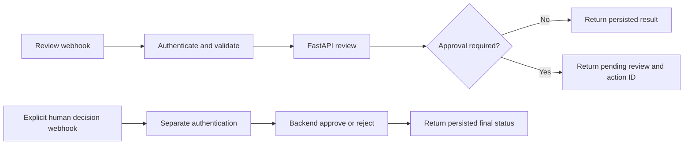

# One optional n8n orchestration workflow

Import `agentic-review-workflow.json` into a local n8n instance. It contains no
credentials, credential objects, pinned payloads, or private endpoint values.
URLs and header values are environment references. FastAPI owns validation,
retrieval, findings, persisted approval proposals, idempotency and audit records.

## Flow



The pending Action in FastAPI is the persisted review item; the executable
ReviewTask is created only after approval. The first entry point never connects
to the decision HTTP node. A second request with separate decision authority is
required. The UI can also approve directly; n8n does not become the business core.

## Environment

- `ASSISTANT_BASE_URL`: local FastAPI origin, normally `http://127.0.0.1:8000`.
- `ASSISTANT_DEMO_REQUESTER_TOKEN`: backend demo requester value.
- `ASSISTANT_DEMO_APPROVER_TOKEN`: backend demo reviewer value.
- `N8N_REVIEW_WEBHOOK_TOKEN`: review webhook key.
- `N8N_DECISION_WEBHOOK_TOKEN`: distinct human-decision webhook key.
- `N8N_BLOCK_ENV_ACCESS_IN_NODE=false`: required for this trusted local export's
  environment expressions. Do not import untrusted workflows into that instance.

All values belong in ignored local settings, not the workflow JSON. The helper
creates local keys under `.local/integrations` without printing them.

## Reproduce the local integration trial

Node.js 24 and a running fixture-mode backend are required. From the project root:

```powershell
backend\.venv\Scripts\python.exe tools\setup_n8n_local.py
backend\.venv\Scripts\python.exe tools\prepare_n8n_local.py
backend\.venv\Scripts\python.exe tools\n8n_local.py start
```

In another terminal:

```powershell
backend\.venv\Scripts\python.exe tools\smoke_n8n.py
```

The verification script sends a synthetic request, checks that no action executes
before approval, submits a separate human decision, repeats approval to verify
idempotency, exercises rejection and a no-action case, and saves only a sanitized
summary. This is simulated human input for testing, not autonomous approval.

Manual UI import is also supported: import the JSON, configure the environment, and assign distinct Header Auth credentials to both webhook nodes.
Publish locally. Webhook paths are `/webhook/agentic-review` and
`/webhook/agentic-review-decision`. Both require the appropriate `X-Workflow-Key`.
Review bodies contain `listing_id`, `workflow`, `request_text`; decision bodies
contain `action_id` and `decision` (`approve` or `reject`). Browser payloads cannot
choose credentials, backend URLs or action arguments.

## Verification and platform boundary

The export was imported and exercised on local n8n 2.42.7: eight checks passed.
See `docs/verification/n8n.json`. The core app works without n8n.

The npm installation is a separate, ignored verification runtime under `.local`.
Its upstream dependency audit reported vulnerable package entries, including
critical severity; the core Python/React audits did not. These counts include
transitive aggregation and are not a demonstrated exploit of this workflow.
Do not expose this tested npm runtime publicly or treat it as production-certified.
Use a maintained platform installation and review n8n's advisories for deployment.
No unsafe major downgrade or forced dependency override was applied to hide findings.

n8n's own package/lockfile and installed code are not included in the public
repository. Execution-payload saving is disabled in the export; FastAPI holds the
authoritative audit trail. npm-based installation is deprecated from n8n 3.0;
the helper is deliberately a local 2.x reproduction tool. Docker execution of
n8n has not been verified here. [Official installation documentation](https://docs.n8n.io/hosting/installation/npm/).
